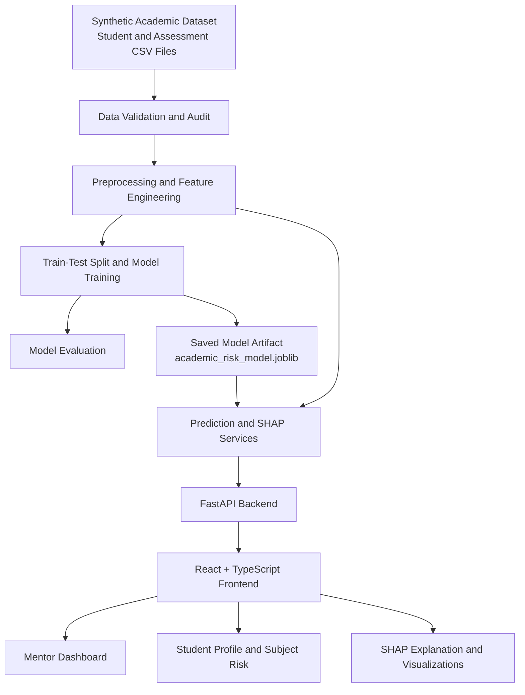
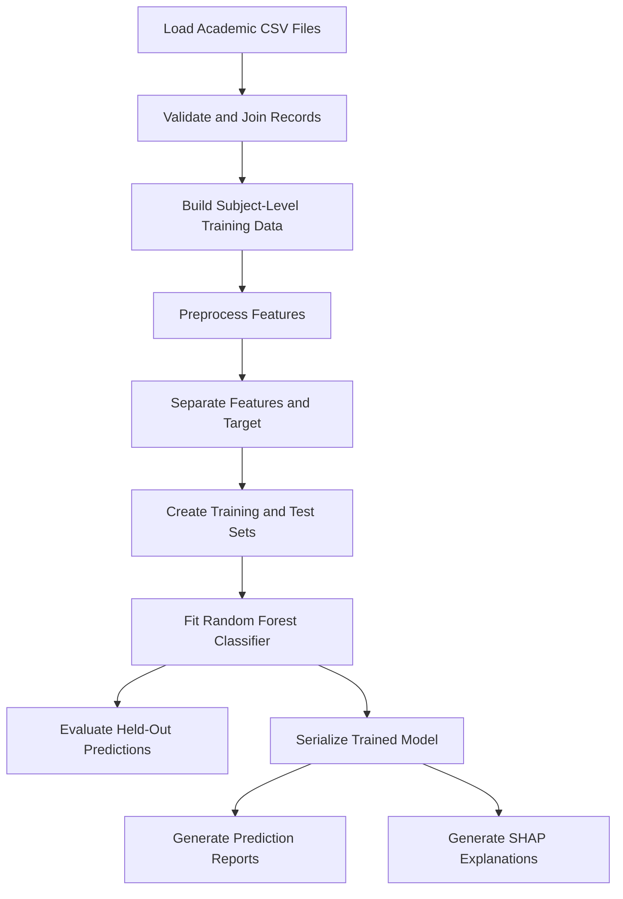

# AI Student Academic Risk Early Warning System

An explainable machine learning system that analyzes student academic assessment data, estimates subject-level academic risk, and helps mentors identify students who may need additional academic support.

**Project Type:** Machine Learning, Explainable AI, Full-Stack Web Application  
**ML Model:** Random Forest  
**Backend:** Python, FastAPI  
**Frontend:** React, TypeScript, Vite  
**Explainability:** SHAP-based feature attribution  
**Dataset:** Synthetic academic dataset for demonstration and experimentation  
**Project Status:** Integrated prototype under development

---

## Table of Contents

- [1. Introduction](#1-introduction)
- [2. Problem Statement](#2-problem-statement)
- [3. Project Objectives](#3-project-objectives)
- [4. Proposed Solution](#4-proposed-solution)
- [5. Key Features](#5-key-features)
- [6. Technology Stack](#6-technology-stack)
- [7. System Architecture](#7-system-architecture)
- [8. Project Folder Structure](#8-project-folder-structure)
- [9. Dataset and Data Preparation](#9-dataset-and-data-preparation)
- [10. Machine Learning Pipeline](#10-machine-learning-pipeline)
- [11. Model Evaluation](#11-model-evaluation)
- [12. Explainable AI Using SHAP](#12-explainable-ai-using-shap)
- [13. Backend and API Design](#13-backend-and-api-design)
- [14. Frontend and Dashboard Design](#14-frontend-and-dashboard-design)
- [15. End-to-End Workflow](#15-end-to-end-workflow)
- [16. Installation and Setup](#16-installation-and-setup)
- [17. API Testing](#17-api-testing)
- [18. Technical Challenges and Solutions](#18-technical-challenges-and-solutions)
- [19. Testing and Validation](#19-testing-and-validation)
- [20. Current Limitations](#20-current-limitations)
- [21. Future Enhancements](#21-future-enhancements)
- [22. Reproducibility and Model Retraining](#22-reproducibility-and-model-retraining)
- [23. Responsible AI and Data Privacy](#23-responsible-ai-and-data-privacy)
- [24. Author and Contribution](#24-author-and-contribution)

---

## 1. Introduction

Academic performance monitoring is an important part of educational institutions. Students may experience difficulties in particular subjects because of low internal assessment scores, inconsistent assignment completion, attendance patterns, or other academic challenges.

Identifying these issues early can help mentors and teachers provide targeted academic support before final examinations.

The **AI Student Academic Risk Early Warning System** is a machine learning-based decision-support application designed to analyze academic records and estimate the probability of a student scoring below a defined threshold in an end-semester examination.

Unlike a system that only displays marks or attendance, this project combines subject-level risk predictions with explainability information. It provides a web interface through which mentors can inspect student profiles, compare subject risks, review contributing features, and identify areas that may require intervention.

The project integrates a trained machine learning model with a FastAPI backend and a React-based frontend.

The current implementation uses synthetic demonstration data. It is a prototype for developing and evaluating the technical workflow, not a validated production system for real students.

## 2. Problem Statement

Traditional academic monitoring often relies on manually reviewing attendance registers, internal examination marks, assignment records, and semester summaries.

This approach can create several challenges:

- **Late identification:** Academic difficulties may not be recognized until end-semester results become available.
- **Fragmented information:** Academic indicators may be stored across multiple datasets or files.
- **Subject-specific difficulties:** A student may perform well overall while struggling in one or more individual subjects.
- **Limited explainability:** A risk score alone does not explain which recorded assessment features influenced a model prediction.
- **Manual workload:** Mentors may need to inspect many student records to prioritize academic support.
- **Inconsistent intervention:** Without structured evidence, support decisions can depend heavily on manual observation.

The problem addressed by this project is:

> How can machine learning be used to estimate subject-level academic risk from pre-examination assessment data and present interpretable evidence that helps mentors prioritize academic support?

The system is intended to assist human decision-making rather than automatically determine a student's academic outcome.

## 3. Project Objectives

1. Develop a structured academic dataset for model development and testing.
2. Build a reproducible data preprocessing and feature engineering pipeline.
3. Train a machine learning classifier for subject-level academic risk estimation.
4. Evaluate model performance using classification metrics.
5. Explain predictions through feature attribution using SHAP.
6. Develop a FastAPI backend to expose student, subject, and explanation data.
7. Integrate the backend with a React and TypeScript frontend.
8. Provide a mentor-oriented interface for reviewing assigned students.
9. Support subject-wise risk visualization and evidence-based academic monitoring.
10. Establish a foundation for future mentor feedback, teacher task assignment, and student support workflows.

## 4. Proposed Solution

The application follows a modular architecture with four main layers.

**Data layer:** Stores synthetic student records, academic assessment records, subject information, and model-generated outputs.

**Machine learning layer:** Preprocesses assessment data, trains the classifier, generates predictions, evaluates performance, and produces explainability artifacts.

**Backend layer:** Uses FastAPI to retrieve student profiles, subject-level predictions, and feature attribution results.

**Frontend layer:** Uses React and TypeScript to present student information, subject risk indicators, explanations, and mentor-oriented support interfaces.

This separation allows the model to be retrained independently of the frontend. The backend can continue serving the model through a stable API contract, provided the model artifact and feature-processing pipeline remain compatible.

## 5. Key Features

### 5.1 Student Academic Profile

The student profile interface displays information such as:

- Student ID and name
- Department and section
- Program and batch year
- Current semester
- Cumulative recorded CGPA
- Semester attendance percentage
- Enrolled subjects and assignment summaries, where available

### 5.2 Subject-Level Risk Prediction

The system retrieves predictions for individual subjects rather than relying exclusively on a single overall student score.

For each subject, the interface can display:

- Subject name and code
- Subject component and credits
- Attendance information
- Predicted risk probability
- Predicted risk category

The current configured risk categories are:

| Category | Probability |
|---|---:|
| Low Risk | 30% or lower |
| Moderate Risk | Above 30% and up to 60% |
| High Risk | Above 60% |

These are prototype thresholds and should not be interpreted as official institutional criteria.

### 5.3 Explainable Predictions

The explanation interface displays the model's baseline probability, predicted probability, feature contributions, and reconstruction checks.

This helps users inspect how recorded input features contributed to an individual prediction.

### 5.4 Academic Risk Visualization

The student detail page includes subject-wise risk bars, risk category indicators, academic summary cards, and a ranked feature-contribution table.

These visualizations are driven by backend responses rather than manually entered display values.

### 5.5 Mentor-Oriented Workflow

The frontend includes a mentor workspace with assigned-student navigation, student search, student detail views, and a mentor assessment interface.

Mentor feedback persistence, complete role-based authorization, and teacher task management remain separate development requirements and should not be assumed to be production-ready.

---

## 6. Technology Stack

| Layer | Technology | Purpose |
|---|---|---|
| Programming language | Python | Data processing and machine learning |
| Data manipulation | Pandas, NumPy | Dataset preparation and numerical operations |
| Machine learning | Scikit-learn | Preprocessing, model training, and evaluation |
| Model explainability | SHAP-based feature attribution | Understanding prediction contributions |
| Model serialization | Joblib | Saving and loading the trained model |
| Backend framework | FastAPI | REST API development |
| API server | Uvicorn | Running the FastAPI application |
| Data exchange | JSON over HTTP | Frontend-backend communication |
| Frontend framework | React | User interface |
| Frontend language | TypeScript | Typed frontend development |
| Build tool | Vite | Development server and production builds |
| Styling | Tailwind CSS | UI styling |
| Package manager | pnpm | Frontend dependency management |
| API testing | FastAPI Swagger UI | Interactive endpoint testing |
| Automated testing | Pytest | Data, model, and backend tests |
| Version control | Git and GitHub | Source code management |

The exact installed package versions should be taken from the project's dependency files.

---

## 7. System Architecture

The system is organized into independent layers so that model training, API services, and UI development can evolve separately.

### High-Level Architecture



### Architecture Components

**1. Data ingestion and validation**

Academic CSV files are loaded and checked for required columns, data types, missing values, duplicate records, and relationship integrity.

**2. Feature engineering**

Assessment data is converted into the structured feature representation expected by the model. Feature transformations must remain consistent between training and inference.

**3. Model training and evaluation**

The training pipeline fits the classifier and evaluates its predictions on held-out data. Evaluation reports are stored separately from the deployed model artifact.

**4. Inference and explainability**

The backend loads the trained artifact and retrieves or calculates predictions and feature attributions for requested student-subject records.

**5. API layer**

FastAPI exposes structured endpoints for health status, student profiles, subject predictions, and explanations.

**6. Presentation layer**

The React frontend calls the API and renders the returned information. It should not independently recreate or fabricate model predictions.

---

## 8. Project Folder Structure

The repository keeps the frontend and the trained model system in separate sibling directories.

```text
ai-student-academic-risk-early-warning-system/
│
├── frontend/
│   └── AI Student Support System/
│       ├── public/
│       ├── src/
│       │   ├── services/
│       │   │   └── api.ts
│       │   ├── App.tsx
│       │   └── other UI components
│       ├── .env
│       ├── .env.example
│       ├── index.html
│       ├── package.json
│       ├── pnpm-lock.yaml
│       ├── tsconfig.json
│       └── vite.config.ts
│
├── trained_model/
│   ├── backend/
│   │   ├── schemas/
│   │   │   ├── health.py
│   │   │   ├── student.py
│   │   │   ├── subject.py
│   │   │   └── explanation.py
│   │   ├── services/
│   │   │   ├── student_service.py
│   │   │   ├── subject_service.py
│   │   │   └── explanation_service.py
│   │   ├── tests/
│   │   ├── config.py
│   │   └── main.py
│   │
│   ├── data/
│   │   └── raw/
│   │       ├── students.csv
│   │       ├── subject_catalog.csv
│   │       ├── academic_records.csv
│   │       ├── semester_summary_cgpa_risk.csv
│   │       ├── assessment_details.csv
│   │       ├── support_plan_tasks.csv
│   │       ├── task_checklist_progress.csv
│   │       ├── complete_connected_dataset.csv
│   │       └── department_counts.csv
│   │
│   ├── ml/
│   │   ├── data/
│   │   │   └── subject_level_training_data.csv
│   │   ├── models/
│   │   │   └── academic_risk_model.joblib
│   │   ├── reports/
│   │   │   ├── subject_level_predictions.csv
│   │   │   ├── individual_shap_explanations.csv
│   │   │   ├── model_evaluation.json
│   │   │   ├── model_comparison.json
│   │   │   ├── shap_validation_report.json
│   │   │   ├── shap_feature_importance.png
│   │   │   └── shap_summary.png
│   │   ├── src/
│   │   │   ├── data_loader.py
│   │   │   ├── preprocessing.py
│   │   │   ├── train.py
│   │   │   ├── evaluate.py
│   │   │   ├── predict.py
│   │   │   ├── explain.py
│   │   │   └── inspect_assessments.py
│   │   └── requirements.txt
│   │
│   ├── tests/
│   │   ├── test_academic_logic.py
│   │   ├── test_data_integrity.py
│   │   ├── test_model_pipeline_and_leakage.py
│   │   └── test_shap_explanations.py
│   │
│   └── README.md
│
├── .gitignore
└── README.md
```

*Note:* This is a documentation-oriented representation of the project structure recorded during development. Confirm exact filenames against the current repository before treating this as an exhaustive file listing.

### Important Directories

**`frontend/AI Student Support System/`**

Contains the React frontend, UI components, environment configuration, and centralized API service.

**`trained_model/data/raw/`**

Contains the source academic CSV datasets used by the project.

**`trained_model/ml/src/`**

Contains the data loading, preprocessing, training, evaluation, prediction, and explainability scripts.

**`trained_model/ml/models/`**

Contains the serialized trained model artifact.

**`trained_model/ml/reports/`**

Contains evaluation results, prediction outputs, SHAP explanations, and visualization artifacts.

**`trained_model/backend/`**

Contains the FastAPI application, response schemas, business logic, and backend tests.

**`trained_model/tests/`**

Contains tests for academic logic, data integrity, leakage checks, and explanation validation.

---

## 9. Dataset and Data Preparation

### 9.1 Dataset Source

The current project uses a **synthetic academic dataset created for demonstration and model development**.

It is not an official dataset obtained from KIET Group of Institutions, and it must not be represented as actual KIET student records.

The dataset was designed to resemble academic record structures so the project could be developed without exposing real student information.

The source files contain different aspects of academic data, including student identity fields, department and section information, subject catalogs, academic records, semester summaries, assessment details, and support-plan-related records.

### 9.2 Dataset Scale

The recorded dataset-generation configuration contains 1,530 synthetic students across multiple departments.

The subject-level training dataset contains 47,550 records.

The exact number of usable records for a particular training run depends on validation, filtering, joins, and feature requirements.

### 9.3 Main Dataset Files

| File | Purpose |
|---|---|
| `students.csv` | Student identifiers and demographic-free academic grouping fields |
| `subject_catalog.csv` | Subject metadata, department information, and subject identifiers |
| `academic_records.csv` | Academic and semester-level records |
| `semester_summary_cgpa_risk.csv` | Semester summaries and recorded academic risk-related fields |
| `assessment_details.csv` | Internal assessment information |
| `complete_connected_dataset.csv` | Connected dataset for integrated analysis |
| `department_counts.csv` | Department-level student counts |
| `support_plan_tasks.csv` | Support-plan task records for prototype workflows |
| `task_checklist_progress.csv` | Task checklist and progress records |

### 9.4 Data Preparation Workflow

The data pipeline includes:

1. Loading the source CSV files.
2. Checking column names, types, and required fields.
3. Validating student and subject identifiers.
4. Checking joins between academic records and subject metadata.
5. Identifying missing, invalid, or duplicate values.
6. Building the subject-level training dataset.
7. Applying feature transformations.
8. Creating training and test partitions.
9. Generating model predictions and evaluation reports.
10. Saving model and explainability artifacts.

### 9.5 Data Integrity Challenge: Subject Identifier Collisions

During dataset auditing, subject identifiers were found to collide across department contexts. For example, identifiers such as `IT301L` and `IT302L` required careful contextual handling.

The project introduced a composite `subject_key`, formed from the department code and subject identifier, to avoid ambiguous joins.

This is important because an incorrect join can associate a student with the wrong subject or assessment record and corrupt downstream predictions.

### 9.6 Data Quality and Provenance

The project includes data lineage, data dictionary, and dataset audit documentation from the development process.

The objective is to preserve traceability between:

- Source records
- Processed training records
- Model predictions
- Explanation outputs
- Frontend display fields

Synthetic data remains a major limitation. Good data integrity does not establish that synthetic patterns reflect real student behaviour.

---

## 10. Machine Learning Pipeline

### 10.1 Prediction Objective

The current model estimates subject-level risk associated with scoring below 40% in a final End-Semester Examination (ESE), using available pre-examination assessment features.

This threshold is a **provisional experimental target**, not a confirmed official KIET examination rule.

The model is intended to identify records that may deserve closer academic review.

### 10.2 Feature Engineering

The model pipeline uses structured assessment features, including examples such as:

- Mid-semester assessment scores
- Class-test scores
- Assignment scores and completion indicators
- Assignment submission counts
- Semester information
- Department-related features
- Other available internal assessment fields

The exact feature list is defined by the training pipeline and the saved model's expected input schema.

Not every source column is necessarily used by the model.

### 10.3 Training Process

The general training workflow is:



The model is trained independently of the frontend. The saved artifact is then loaded by the inference pipeline and served through the backend.

### 10.4 Saved Model Artifact

The serialized model is stored at:

`trained_model/ml/models/academic_risk_model.joblib`

The artifact allows the application to reuse a trained model without fitting it again every time a student profile is opened.

For reproducible inference, the saved model must remain compatible with the preprocessing logic, feature order, and dependencies used by the application.

### 10.5 Prediction Output

The subject-level prediction report contains 47,550 records according to the recorded development results.

For each prediction, the system can expose fields such as:

- Student and subject identifiers
- Predicted risk probability
- Predicted risk category
- Binary target-related prediction
- Relevant attendance and assessment information

The exact output schema is defined by the current prediction pipeline and backend response models.

### 10.6 Risk Classification

The application uses the following risk bands:

- Low: probability up to and including 0.30
- Moderate: probability above 0.30 and up to and including 0.60
- High: probability above 0.60

The binary classification threshold used in the recorded pipeline is 0.50.

These thresholds serve different purposes: the binary threshold determines a predicted class, while the three risk bands support user-facing prioritization.

Neither should be confused with the actual probability that a particular student will fail in a real examination.

---

## 11. Model Evaluation

The recorded evaluation results for the Random Forest model are:

| Metric | Recorded Result |
|---|---:|
| Accuracy | 86.71% |
| Macro F1-score | 70.61% |
| Recall for the below-40% target class | 60.76% |
| Precision for the below-40% target class | 40.86% |
| False negatives in the recorded test set | 381 |

These figures come from the project's synthetic-data evaluation. They should be rechecked against the current `model_evaluation.json` before being used in a formal report or publication.

### 11.1 Interpreting the Results

**Accuracy — 86.71%**

The model correctly classified approximately 86.71% of the evaluated records under the recorded evaluation setup.

Accuracy alone is insufficient for judging a risk-detection model, particularly when the target classes are imbalanced.

**Macro F1-score — 70.61%**

Macro F1 averages the F1-score across classes, giving each class equal weight. It helps reveal performance differences that overall accuracy may hide.

**Recall — 60.76%**

The model identified approximately 60.76% of the actual positive target-class records in the held-out evaluation.

**Precision — 40.86%**

Among records predicted as positive, approximately 40.86% belonged to the positive target class under the recorded evaluation.

**False negatives — 381**

The recorded evaluation contained 381 positive target-class examples that the model failed to identify. In a real early-warning setting, missed high-risk students would be a significant concern.

### 11.2 Evaluation Limitations

The results are preliminary because:

- The data is synthetic.
- Real-world generalization has not been established.
- The target threshold is provisional.
- Precision and recall show that errors remain substantial.
- Real academic data may exhibit different distributions and relationships.
- Calibration and performance across departments or student groups require further investigation.

A high accuracy score does not make this model suitable for autonomous academic decisions.

---

## 12. Explainable AI Using SHAP

### 12.1 Why Explainability Matters

A probability alone does not tell a mentor which recorded assessment features influenced a prediction.

SHAP-based feature attribution provides a way to inspect how individual input features contribute to the model output relative to a baseline.

The project uses explanation outputs to help users examine model behaviour rather than treating a risk label as an unquestionable conclusion.

### 12.2 Explanation Workflow

The recorded explanation pipeline provides:

- Baseline probability
- Predicted probability
- Feature-level SHAP contributions
- Ranked feature explanations
- Reconstruction or additivity validation
- An aggregate residual for omitted feature contributions

### 12.3 Explanation Coverage

The development artifacts include:

- `individual_shap_explanations.csv`
- `shap_validation_report.json`
- `shap_feature_importance.png`
- `shap_summary.png`

The recorded individual explanation export covers 100 records, with 11 rows per record: the top ten feature entries and a residual row.

The backend can calculate explanations for uncached records when needed, according to the current implementation.

The 100-record cached explanation export should not be mistaken for full-cohort precomputed explanation coverage.

### 12.4 Additivity Validation

The explanation validation process checks whether the feature contributions, including the residual contribution where applicable, reconstruct the reported model output within the chosen tolerance.

The recorded validation report indicates that reconstruction was validated for the tested explanation outputs.

The UI's additivity status refers to this mathematical reconstruction check. It does not prove that the model is accurate or that its explanations are causally correct.

### 12.5 Important Interpretation Warning

SHAP values describe how features contribute to a model prediction under its explanation setup. They do not prove that a feature caused a student's academic outcome.

For example, an internal assessment score contributing to a high predicted risk does not establish why the student obtained that score.

Mentors should interpret explanations alongside verified academic records and human review.

---

## 13. Backend and API Design

The backend is implemented using FastAPI.

It loads the required model and data artifacts and returns structured responses that can be consumed by the frontend.

### 13.1 Backend Structure

The backend separates concerns into:

- **`main.py`:** Application initialization and API route definitions.
- **`config.py`:** Configuration such as paths and allowed frontend origins.
- **`schemas/`:** Response and request schemas.
- **`services/`:** Data retrieval, prediction access, and explanation logic.
- **`tests/`:** API endpoint tests.

### 13.2 Available Endpoints

| Method | Endpoint | Purpose |
|---|---|---|
| GET | `/health` | Health status and model/data availability |
| GET | `/api/v1/health` | Versioned health endpoint |
| GET | `/students/{student_id}` | Student profile and academic summary |
| GET | `/students/{student_id}/subjects?semester={n}` | Subject records and risk predictions |
| GET | `/students/{student_id}/semesters/{sem}/subjects` | Semester-specific subject lookup |
| GET | `/students/{student_id}/subjects/{subject_key}/explanation?semester={n}` | SHAP explanation for a subject |

Exact aliases and parameter behaviour should be verified in the current FastAPI application.

### 13.3 Example Health Response

```json
{
  "status": "healthy",
  "version": "1.0.0",
  "dataset_status": "synthetic_demo_loaded",
  "model_status": "available",
  "disclaimer": "All academic records are synthetic demo data. Predictions and risk thresholds are experimental."
}
```

### 13.4 API Documentation

FastAPI automatically provides interactive API documentation.

- Swagger UI: `http://127.0.0.1:8000/docs`
- ReDoc: `http://127.0.0.1:8000/redoc`

These pages can be used to test the API without using the frontend.

### 13.5 CORS and Browser Communication

The backend must allow requests from the frontend origin being used.

For local development, `localhost` and `127.0.0.1` are distinct browser origins, and an IP-based frontend URL is a different origin again.

CORS must be configured explicitly for the required development origins. If the frontend is accessed from another device, the backend address must also be reachable from that device.

---

## 14. Frontend and Dashboard Design

The frontend uses React, TypeScript, Vite, and Tailwind CSS.

It is located separately from the backend and trained model.

### 14.1 Centralized API Layer

The API integration is organized in:

`frontend/AI Student Support System/src/services/api.ts`

The centralized service module includes functions such as:

- `getHealth()`
- `getStudentProfile(studentId)`
- `getStudentSubjects(studentId, semester)`
- `getSubjectExplanation(studentId, subjectKey, semester)`

These functions communicate with the backend and provide typed responses to the UI.

The API base URL is configured using `VITE_API_BASE_URL` rather than being scattered throughout UI components.

### 14.2 Mentor Dashboard

The mentor interface is designed to support:

- Assigned-student navigation
- Student name and ID search
- Department and section filtering
- Academic summary information
- Subject-level risk indicators
- Access to student details

Mentor assignment rules and roster completeness depend on the current implementation. A small sample roster should not be treated as a complete institutional roster.

### 14.3 Student Detail Page

The student detail view integrates several model-driven sections:

**Overall academic risk summary**

Shows a summary of the subject-level risk distribution for the selected semester.

**Subject-wise academic risk analysis**

Shows individual subjects, assessment-related metadata, and predicted risk probabilities.

**Why is this student at risk?**

Shows the SHAP-based feature attribution for the selected subject.

**Recommended mentor action plan**

Displays support guidance where the current implementation has usable evidence and recommendations. It must not fabricate explanations or claim that unimplemented persistence features are working.

**Academic performance visualizations**

Shows subject risk bars and academic summary metrics available from the backend.

### 14.4 Loading and Error States

The frontend includes loading indicators, error banners, and unavailable-data states.

A network error should not be reported as a confirmed missing student. A genuine HTTP 404 response and a failed network request are different conditions and should be handled separately.

### 14.5 Current Prototype Boundaries

The integrated UI demonstrates the main data flow, but a complete production workflow requires additional work around authentication, role-based access, feedback persistence, teacher tasks, and data governance.

---

## 15. End-to-End Workflow

The following sequence describes the intended data flow from source records to the mentor interface.

1. Source CSV files are loaded and validated.
2. Academic and subject records are joined using appropriate identifiers.
3. Subject-level training data is generated.
4. Features are preprocessed using the training pipeline.
5. The model is trained and evaluated.
6. The trained model is serialized to a Joblib artifact.
7. Prediction reports and explanation artifacts are generated.
8. FastAPI loads the required artifacts.
9. The frontend requests student and subject information.
10. The backend returns structured JSON responses.
11. The frontend displays subject-level risk estimates.
12. When a subject is selected, the frontend requests its explanation.
13. The backend returns feature contributions and validation information.
14. The mentor reviews the evidence and decides whether further academic support is appropriate.

The UI does not train the model. Training and inference are separate processes.

---

## 16. Installation and Setup

### Prerequisites

Install the following:

- Python
- Node.js
- pnpm
- Git

Use the versions compatible with the dependency files in the repository.

### 16.1 Clone the Repository

```bash
git clone https://github.com/YOUR_USERNAME/ai-student-academic-risk-early-warning-system.git
cd ai-student-academic-risk-early-warning-system
```

Replace `YOUR_USERNAME` with the actual GitHub account name.

### 16.2 Start the Backend

Open a terminal in the project root:

```powershell
cd trained_model
```

Activate the Python environment used by the project and install the required dependencies if they are not already installed.

The model pipeline and backend dependencies may be specified in separate requirement files. Install from the appropriate dependency files after checking their contents.

Start FastAPI:

```powershell
python -m uvicorn backend.main:app --host 127.0.0.1 --port 8000 --reload
```

Open:

`http://127.0.0.1:8000/health`

A healthy response should indicate that the backend is running and report the model and dataset status.

### 16.3 Configure the Frontend

Open another terminal:

```powershell
cd "frontend\AI Student Support System"
```

Install dependencies:

```powershell
pnpm install
```

Check the `.env` file and configure the backend URL:

```env
VITE_API_BASE_URL=http://127.0.0.1:8000
```

This configuration is suitable when the frontend and backend are running on the same development computer.

Do not commit secrets or private configuration values to the repository.

### 16.4 Start the Frontend

```powershell
pnpm dev
```

Open the local URL printed by Vite, normally:

`http://localhost:8443/`

The actual port may differ if the configured port is unavailable.

### 16.5 Build the Frontend

```powershell
pnpm build
```

The recorded integration run completed a production build successfully. Run this command again after subsequent changes to confirm the current repository still builds.

### 16.6 Run Tests

From the `trained_model` directory, the previously used test command was:

```powershell
python -m pytest tests backend/tests -v
```

Run it after installing the required dependencies and ensure that both test directories exist in the current checkout.

---

## 17. API Testing

### Health Check

Request:

```http
GET /health
```

Expected outcome: a JSON response describing application health and model/data availability.

### Student Profile

Request:

```http
GET /students/2428CS2286
```

The recorded development example returned a synthetic student profile for Atharv Saxena.

The actual result depends on the current dataset and should be verified against the API response.

### Subject Predictions

Request:

```http
GET /students/2428CS2286/subjects?semester=5
```

Inspect the returned subject identifiers, attendance information, predicted probabilities, and risk categories.

### SHAP Explanation

Request:

```http
GET /students/2428CS2286/subjects/CS_CS308E/explanation?semester=5
```

The subject key is an example and must exist in the current dataset. Copy the exact `subject_key` returned by the subject endpoint when testing.

Verify the baseline, predicted probability, contribution values, and reconstruction status.

### Important Testing Rule

A successful HTTP response confirms that an endpoint returned a response. It does not independently prove that the model is well calibrated, that every displayed value is correct, or that a prediction will generalize to real students.

---

## 18. Technical Challenges and Solutions

### 18.1 Ambiguous Subject Identifiers

**Challenge:** Subject codes can be ambiguous across departments or data sources.

**Solution:** Introduce a department-aware composite subject key so joins and API requests can distinguish otherwise conflicting subject identifiers.

**Lesson:** Database relationships must use stable, unambiguous identifiers rather than assuming a subject code is globally unique.

### 18.2 Dataset Integrity Across Multiple CSV Files

**Challenge:** Student records, academic records, subject catalogs, and assessment records must remain consistent when joined.

**Solution:** Add data audits, relationship checks, and a documented data lineage workflow.

**Lesson:** Incorrect joins can silently corrupt features and model outputs even when the code executes without errors.

### 18.3 Reproducible Feature Processing

**Challenge:** Training and inference must use compatible features and transformations.

**Solution:** Keep preprocessing logic organized in the ML pipeline and ensure inference consumes the expected feature representation.

**Lesson:** A serialized estimator alone is not enough if its inference inputs differ from the data used during training.

### 18.4 False Negatives in Risk Detection

**Challenge:** The recorded model missed 381 positive target-class examples in the held-out test data.

**Solution:** Evaluate precision and recall alongside accuracy, inspect false negatives, and investigate threshold selection.

**Lesson:** In an early-warning application, missed at-risk cases can matter more than overall accuracy suggests.

### 18.5 SHAP Explanation Reconstruction

**Challenge:** Displaying only the top-ranked features may omit part of the total attribution.

**Solution:** The explanation pipeline includes an aggregate residual for omitted contributions and checks reconstruction against the model output.

**Lesson:** Feature attribution visualizations should preserve mathematical consistency and clearly identify omitted contributions.

### 18.6 Explanation Computation Cost

**Challenge:** Computing individual explanations for every record can be expensive.

**Solution:** The recorded workflow stores explanations for a subset of records and calculates uncached explanations on demand.

**Lesson:** Explanation caching should be designed around expected usage, computational cost, and the freshness of model artifacts.

### 18.7 Frontend-Backend Integration

**Challenge:** The frontend needs stable response schemas, a reachable backend URL, and correct CORS configuration.

**Solution:** Use a centralized API service, typed interfaces, configurable API URLs, and explicit loading and error states.

**Lesson:** A backend that works independently does not guarantee that browser requests will succeed. Browser origin, network access, and environment configuration also matter.

### 18.8 Separating Model Output from UI Logic

**Challenge:** A polished UI can inadvertently display hardcoded or stale values as if they were current predictions.

**Solution:** Retrieve profile data, subject predictions, and explanation outputs from their corresponding backend endpoints.

**Lesson:** Every model-driven display should have a clear data source and an appropriate unavailable-data state.

### 18.9 Synthetic Data Limitations

**Challenge:** Synthetic records make it possible to build and test the application without real student records, but they may not represent real academic patterns.

**Solution:** Label synthetic data clearly and separate engineering validation from real-world model validation.

**Lesson:** Passing software tests does not establish that a model is suitable for real educational decisions.

---

## 19. Testing and Validation

The development process includes several layers of validation.

### Data and ML Tests

The recorded pipeline test run reported 18 passing tests covering data and model-related checks.

### Backend Tests

The recorded integrated test run reported 31 total passing tests across the ML and backend test suites, with one warning.

These are historical development results. They should be rerun against the current checkout to confirm the same status.

### Validation Categories

| Area | Validation Goal |
|---|---|
| Data integrity | Confirm required fields and valid relationships |
| Academic logic | Check target and risk-related calculations |
| Leakage checks | Identify inappropriate information leakage into training |
| Model evaluation | Measure classification performance on held-out data |
| SHAP validation | Check attribution reconstruction |
| API tests | Verify endpoint responses and error handling |
| Frontend build | Verify successful TypeScript and Vite compilation |
| Integration checks | Verify the UI retrieves the expected backend data |

A comprehensive production validation process would additionally require testing with appropriately governed real data, calibration analysis, subgroup evaluation, security testing, and user acceptance testing.

---

## 20. Current Limitations

1. **Synthetic data:** The model has not been validated on official institutional student records.
2. **Provisional target:** The below-40% ESE threshold is experimental and is not asserted to be an official institutional rule.
3. **False negatives:** The recorded evaluation indicates that some positive target-class cases are missed.
4. **Limited explanation cache:** The recorded individual SHAP export covers 100 records, not the entire dataset.
5. **No causal inference:** Feature contributions describe model behaviour, not verified causes of academic performance.
6. **Prototype authentication:** The current demo login does not provide production-grade identity verification.
7. **Role-based access:** Proper authorization must be implemented before sensitive academic data can be safely exposed.
8. **Mentor feedback persistence:** The feedback interface has been identified as a UI-only feature pending backend persistence.
9. **Task workflow:** Complete teacher task creation, deadline management, and student completion tracking require further implementation and verification.
10. **Roster completeness:** Mentor assignment and roster coverage must be verified against the complete eligible dataset.
11. **Model calibration:** A predicted probability is not automatically a well-calibrated real-world probability.
12. **Operational security:** The development server configuration is not intended for unrestricted public deployment.

---

## 21. Future Enhancements

### Model Improvements

- Evaluate additional classifiers and compare them using consistent data splits.
- Improve recall for students at risk while measuring the impact on false positives.
- Investigate probability calibration.
- Perform error analysis by subject, department, and assessment pattern.
- Validate the model using approved, anonymized real academic data.
- Track model versions, training configurations, and evaluation results.

### Backend Improvements

- Add secure authentication and role-based authorization.
- Implement persistent mentor feedback records.
- Add subject-teacher routing and task assignment endpoints.
- Support task deadlines and completion tracking.
- Provide a proper assigned-student roster API.
- Add structured logging and API monitoring.
- Version model artifacts and inference contracts.

### Frontend Improvements

- Complete subject and teacher autocomplete workflows.
- Improve mentor assignment visibility and roster filtering.
- Add historical academic trend visualizations where reliable data exists.
- Improve accessibility, responsiveness, and error recovery.
- Clearly distinguish model estimates, recorded academic facts, and mentor-entered notes.

### Responsible AI Improvements

- Introduce human review before consequential interventions.
- Establish data retention and access-control policies.
- Document model limitations and changes across versions.
- Monitor prediction errors and potential subgroup disparities.
- Ensure students are not penalized solely on the basis of a model score.

---

## 22. Reproducibility and Model Retraining

The model is separate from the frontend. Retraining the model should be treated as an ML pipeline operation, not as a frontend build operation.

### Retraining Workflow

1. Review and validate the source dataset.
2. Confirm the target definition and feature availability.
3. Run the preprocessing and training pipeline.
4. Evaluate the new model on held-out data.
5. Compare its metrics with the currently deployed model.
6. Validate the new artifact and its explanation behaviour.
7. Update the deployed model only after successful validation.
8. Restart or reload the backend as required by the implementation.
9. Run API and frontend integration tests.

The project contains the training script at:

`trained_model/ml/src/train.py`

The precise command-line arguments and invocation should be taken from the current script and its dependency configuration. Do not assume that simply running a training script is safe to do against the deployed artifact.

### Protecting the Existing Model

Before retraining, preserve the existing model artifact and relevant evaluation reports.

A safer deployment process is to save a candidate model separately, evaluate it, and only then promote it to the active artifact location.

Retraining may change the predictions even when the API and UI remain unchanged. The frontend should continue to consume the same API schema, but the actual probabilities and explanations may differ.

---

## 23. Responsible AI and Data Privacy

This project is a decision-support prototype, not an automated student evaluation authority.

The following principles apply:

- Synthetic data must not be represented as real institutional records.
- Risk estimates should be reviewed by qualified academic staff.
- SHAP contributions must not be presented as proof of causation.
- Students should not be penalized solely because of model predictions.
- Real academic data requires appropriate authorization, access controls, and data protection.
- Public repositories should not contain private student information, credentials, or secret configuration.
- The development server must not be exposed publicly without appropriate security controls.
- Model limitations, errors, and uncertainty should be communicated clearly.

The goal is to help mentors identify students who may benefit from additional support, not to label students permanently or make high-stakes decisions automatically.

---

## 24. Author and Contribution

**Author:** Saqib Khan

**Contributors** Ashwani Kumar, Anshuman Vaidya, Bhumika Gupta

**Project:** AI Student Academic Risk Early Warning System

Contributions, bug reports, and suggestions can be submitted through the repository's issue tracker.

For changes involving model training, preprocessing, or prediction schemas, include updated tests and evaluation evidence so that the impact on the existing model and frontend can be assessed.

---

## Conclusion

The AI Student Academic Risk Early Warning System demonstrates an end-to-end workflow for academic risk estimation using machine learning, explainability, REST APIs, and a web interface.

The project combines structured data processing, a trained classifier, SHAP-based explanation outputs, a FastAPI backend, and a React frontend in a modular architecture.

Its current value is as a technical prototype that demonstrates how model-driven academic monitoring can be built and integrated. Further work on real-world validation, calibration, security, role-based access, and persistent support workflows is necessary before it can be used for actual institutional decisions.
