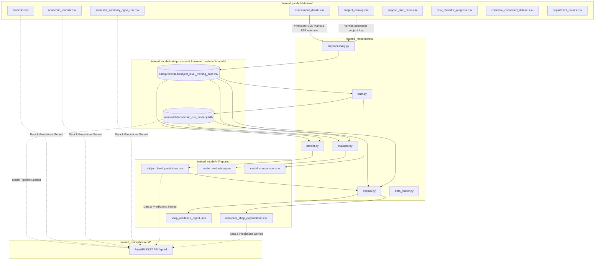

# AI Student Academic Risk Early Warning System

**Version:** 2.0 (Consolidated Machine Learning & API Architecture)  
**Batch Scope:** KIET Batch 2024–2028 (Synthetic Demonstration Dataset)  
**Last Updated:** October 2026  

---

## Table of Contents

1. [Project Overview](#1-project-overview)
2. [Project Objectives](#2-project-objectives)
3. [Complete Folder Structure](#3-complete-folder-structure)
4. [Technology Stack](#4-technology-stack)
5. [Dataset Overview](#5-dataset-overview)
6. [Dataset File Descriptions](#6-dataset-file-descriptions)
7. [Data Dictionary and Important Columns](#7-data-dictionary-and-important-columns)
8. [Data Lineage and Relationships](#8-data-lineage-and-relationships)
9. [Data Audit Findings](#9-data-audit-findings)
10. [Machine Learning Pipeline](#10-machine-learning-pipeline)
11. [Preprocessing and Feature Engineering](#11-preprocessing-and-feature-engineering)
12. [Training Workflow](#12-training-workflow)
13. [Model Architecture and Artifact Details](#13-model-architecture-and-artifact-details)
14. [Model Evaluation Results](#14-model-evaluation-results)
15. [Prediction Generation](#15-prediction-generation)
16. [SHAP Explainability](#16-shap-explainability)
17. [FastAPI Backend Architecture](#17-fastapi-backend-architecture)
18. [Existing API Endpoints](#18-existing-api-endpoints)
19. [API Response and Frontend Data Contract](#19-api-response-and-frontend-data-contract)
20. [Risk Categories and Thresholds](#20-risk-categories-and-thresholds)
21. [Installation and Dependencies](#21-installation-and-dependencies)
22. [Commands to Run the Backend](#22-commands-to-run-the-backend)
23. [Commands to Run Tests](#23-commands-to-run-tests)
24. [How to Retrain the Model](#24-how-to-retrain-the-model)
25. [How to Evaluate and Activate a New Model](#25-how-to-evaluate-and-activate-a-new-model)
26. [Model Versioning and Rollback](#26-model-versioning-and-rollback)
27. [Current Limitations](#27-current-limitations)
28. [Synthetic Dataset and Research Limitations](#28-synthetic-dataset-and-research-limitations)
29. [Future Frontend Integration](#29-future-frontend-integration)
30. [Troubleshooting](#30-troubleshooting)

---

## 1. Project Overview

The **AI Student Academic Risk Early Warning System** is an institutional early-warning machine learning platform engineered to detect undergraduate engineering students at risk of underperforming in university End-Semester Examinations (ESE). 

By analyzing pre-examination continuous evaluations—such as mid-semester examinations, class tests, homework assignments, and internal lab assessments—the system generates subject-level risk probabilities ($P(\text{ESE} < 40\%)$), stratifies students into operational triage tiers (`Low`, `Moderate`, `High`), and computes mathematically closed SHAP (SHapley Additive exPlanations) attributions to explain *why* a particular student is flagged for academic risk.

The platform includes:
- A centralized data lake of 9 relational source datasets spanning 1,530 students and 47,550 course enrollments across 8 engineering disciplines.
- A scikit-learn machine learning pipeline trained with student-level group partitioning to eliminate data leakage.
- A high-performance FastAPI backend serving REST endpoints for student profiles, subject predictions, and on-demand or cached SHAP explanations.

---

## 2. Project Objectives

1. **Early Academic Intervention:** Flag subject-specific academic failure risk weeks prior to the final examination period, allowing faculties, academic advisors, and mentors to intervene proactively.
2. **Interpretability & Transparency:** Deliver individual feature-level attributions for every prediction, pinpointing whether risk stems from specific assignment defaults, mid-sem score deficits, or class test dips.
3. **Mathematical Rigor & Additivity:** Enforce exact additivity closure on feature contributions via an aggregate residual term, guaranteeing that explanation sums reconstruct the model's output probability without unexplained discrepancies.
4. **Architectural Separation:** Decouple objective machine learning probabilities from qualitative mentor notes and remedial task workflows to avoid subjective bias in predictive modeling.
5. **Production Readiness:** Provide standardized, modular REST APIs with deterministic test suites, dynamic path resolution, and full test coverage across data integrity, model logic, and backend serving.

---

## 3. Complete Folder Structure

The entire ML, API, data, and testing infrastructure is organized under `trained_model/`:

```text
student-academic-risk-early-warning-system/
│
├── trained_model/
│   ├── README.md                      # Authoritative single-source project documentation
│   ├── .gitignore                     # Git ignore rules (bytecode, pytest cache, .env)
│   ├── .env.example                   # Environment configuration template (CORS origins)
│   │
│   ├── backend/                       # Production FastAPI Application
│   │   ├── __init__.py
│   │   ├── main.py                    # FastAPI application definition and route declarations
│   │   ├── config.py                  # Dynamic path resolution & runtime settings
│   │   ├── schemas/                   # Pydantic v2 data models for API contracts
│   │   │   ├── __init__.py
│   │   │   ├── explanation.py         # SHAP explanation response schema
│   │   │   ├── health.py              # Health check status schema
│   │   │   ├── student.py             # Student profile & academic summary schema
│   │   │   └── subject.py             # Subject prediction & course record schema
│   │   ├── services/                  # Business logic and ML serving layer
│   │   │   ├── __init__.py
│   │   │   ├── explanation_service.py # Dual-mode SHAP serving (cache + on-demand)
│   │   │   ├── student_service.py     # Student record lookup & aggregation
│   │   │   └── subject_service.py     # Course lookup & prediction binding
│   │   └── tests/                     # Automated FastAPI endpoint integration tests
│   │       ├── __init__.py
│   │       ├── conftest.py            # TestClient fixture
│   │       ├── test_explanations.py   # Explanation endpoint tests (cached & on-demand)
│   │       ├── test_health.py         # System health & status tests
│   │       ├── test_students.py       # Student profile endpoint tests
│   │       └── test_subjects.py       # Subject prediction endpoint tests
│   │
│   ├── data/                          # Centralized Data Directory
│   │   ├── raw/                       # Centralized original academic CSV datasets (10 files)
│   │   │   ├── README.txt             # Dataset provenance notes & batch description
│   │   │   ├── academic_records.csv   # Subject-level scores & attendance (47,550 rows)
│   │   │   ├── assessment_details.csv # Granular assessment log (451,500 rows)
│   │   │   ├── complete_connected_dataset.csv # Denormalized reference join (47,550 rows)
│   │   │   ├── department_counts.csv  # Student counts by dept and section (22 rows)
│   │   │   ├── semester_summary_cgpa_risk.csv # Term GPAs, CGPA & attendance (7,650 rows)
│   │   │   ├── students.csv           # Student master entity (1,530 rows)
│   │   │   ├── subject_catalog.csv    # Course catalog across departments (231 rows)
│   │   │   ├── support_plan_tasks.csv # Remedial intervention tasks (3,060 rows)
│   │   │   └── task_checklist_progress.csv # Actionable subtask milestones (13,796 rows)
│   │   │
│   │   └── processed/                 # Derived training datasets
│   │       └── subject_level_training_data.csv # Engineered ML dataset (47,550 rows)
│   │
│   ├── ml/                            # Machine Learning Engine
│   │   ├── requirements.txt           # ML pipeline Python package dependencies
│   │   ├── src/                       # ML source modules
│   │   │   ├── __init__.py
│   │   │   ├── data_loader.py         # Programmatic data loaders with subject_key generation
│   │   │   ├── preprocessing.py       # Raw assessment aggregation & feature extraction
│   │   │   ├── train.py               # Model training with GroupShuffleSplit (Zero leakage)
│   │   │   ├── evaluate.py            # Independent held-out test split evaluation
│   │   │   ├── predict.py             # Cohort-wide prediction generator (47,550 rows)
│   │   │   ├── explain.py             # Sampled SHAP generator with Rank 11 residual closure
│   │   │   └── inspect_assessments.py # Script for assessing assessment type distributions
│   │   │
│   │   ├── models/                    # Serialized model artifacts
│   │   │   ├── .gitkeep
│   │   │   └── academic_risk_model.joblib # Trained Pipeline (ColumnTransformer + RF)
│   │   │
│   │   └── reports/                   # Model performance reports & visual artifacts
│   │       ├── .gitkeep
│   │       ├── model_comparison.json  # RF vs. Logistic Regression comparison metrics
│   │       ├── model_evaluation.json  # Standalone held-out test evaluation report
│   │       ├── shap_validation_report.json # SHAP mathematical closure validation report
│   │       ├── subject_level_predictions.csv # Full cohort predictions (47,550 rows)
│   │       ├── individual_shap_explanations.csv # Sampled SHAP explanations (1,100 rows)
│   │       ├── shap_feature_importance.png # Cohort-level global SHAP summary bar chart
│   │       └── shap_summary.png       # Cohort-level beeswarm SHAP distribution plot
│   │
│   ├── tests/                         # ML & Data Pipeline Automated Tests
│   │   ├── test_academic_logic.py     # Marks summation, percentage, and pass/fail rules
│   │   ├── test_data_integrity.py     # Candidate key uniqueness & zero missing checks
│   │   ├── test_model_pipeline_and_leakage.py # Group partition disjointness & leakage
│   │   └── test_shap_explanations.py  # SHAP additivity error <= 1e-4 verification
│   │
│   └── backups/                       # Safe Archival Backups
│       ├── pre_audit_backup/          # Original artifacts before model retraining audit
│       └── docs_archive/              # Original modular Markdown documents (pre-consolidation)
│
└── frontend/                          # Future frontend workspace (Sibling directory; not yet created)
```

---

## 4. Technology Stack

| Domain | Technology / Library | Version / Specification | Role in Architecture |
|---|---|---|---|
| **Runtime** | Python | 3.13.x | Core programming language |
| **API Framework** | FastAPI | 0.115+ | High-performance asynchronous REST API backend |
| **ASGI Server** | Uvicorn | 0.34+ | ASGI web server for running FastAPI |
| **Data Validation** | Pydantic | 2.10+ | Strict type validation and JSON schema enforcement |
| **Machine Learning** | Scikit-learn | 1.6+ | Preprocessing pipelines, ColumnTransformer, RandomForest, LogisticRegression |
| **Model Explainability** | SHAP | 0.54.1 | Model-agnostic PermutationExplainer for feature attributions |
| **Data Processing** | Pandas | 2.2+ | Tabular manipulation, pivoting, and joins |
| **Numerical Engine** | NumPy | 2.2+ | Array transformations and mathematical calculations |
| **Visualization** | Matplotlib / Seaborn | 3.10+ / 0.13+ | Static SHAP summary and feature importance charts |
| **Model Serialization** | Joblib | 1.4+ | Atomic serialization of fitted scikit-learn pipelines |
| **Automated Testing** | Pytest / Starlette TestClient | 8.3+ | 31 automated integration and unit test suites |

---

## 5. Dataset Overview

The system models the academic journey of the **KIET Batch 2024–2028** across semesters 1 through 5.

- **Total Students:** 1,530 undergraduate engineering students.
- **Academic Program:** Bachelor of Technology (B.Tech).
- **Departments (8):**
  - `CS`: Computer Science
  - `CSE`: Computer Science & Engineering
  - `CSEAIML`: Computer Science & Engineering (AI & ML)
  - `CSIT`: Computer Science & Information Technology
  - `ECE`: Electronics & Communication Engineering
  - `EEE`: Electrical & Electronics Engineering
  - `IT`: Information Technology
  - `ME`: Mechanical Engineering
- **Sections:** `A`, `B`, `C`, `D` within each department.
- **Enrolled Semesters:** 1 to 5 (current active semester is Semester 5).
- **Total Course Enrollments:** 47,550 student-subject-semester records.
- **Total Granular Assessment Logs:** 451,500 assessment instances.
- **Support Plan Remedial Tasks:** 3,060 assigned intervention tasks across 13,796 actionable checklist milestones.

---

## 6. Dataset File Descriptions

All source CSV files are centralized in `trained_model/data/raw/`:

1. **`students.csv` (1,530 rows, 8 cols):**  
   Master entity defining each student's identity (`student_id`), demo name (`student_name`), engineering department code (`department_code`), full department name (`department_name`), classroom section (`section`), program (`program` = "B.Tech"), graduation year (`batch_year` = 2028), and active semester (`current_semester` = 5).

2. **`subject_catalog.csv` (231 rows, 6 cols):**  
   Curriculum master defining all 231 courses prescribed across the 8 departments. Contains `department_code`, prescribed `semester`, course code (`subject_id`), course name (`subject_name`), delivery mode (`component`: `THEORY`, `PRACTICAL`, `BLENDED`, `AUDIT`, `PROFESSIONAL ELECTIVE-I`, `PROFESSIONAL ELECTIVE-II`), credit weight (`credits`: 0 to 4), and the collision-free composite key (`subject_key`).

3. **`academic_records.csv` (47,550 rows, 33 cols):**  
   Semester-by-semester course performance table. Captures attendance counts (`classes_attended`, `total_classes`, `attendance_percentage`), internal marks (`mid_sem_marks`, `class_test_1_marks`, `class_test_2_marks`, `assignment_marks`, `other_internal_marks`), assignment submission counts (`assignments_submitted`, `total_assignments`, `assignments_pending`), terminal exam marks (`end_sem_marks`), overall aggregates (`grand_total_marks`, `grand_total_percentage`), and provisional outcome (`subject_result`).

4. **`semester_summary_cgpa_risk.csv` (7,650 rows, 11 cols):**  
   Aggregated term summaries (1,530 students $\times$ 5 semesters). Includes term GPA (`semester_gpa_synthetic`), cumulative grade point average (`cumulative_cgpa_synthetic`), term attendance average (`semester_attendance_percentage`), weighted term score (`semester_weighted_marks_percentage`), total incomplete assignments (`pending_assignments_total`), and count of courses passed (`subjects_passed`, `subjects_total`).

5. **`assessment_details.csv` (451,500 rows, 11 cols):**  
   High-granularity transactional log of every individual evaluation item. Records `assessment_type` (`Mid Semester`, `Class Test`, `Assignment`, `Other Internal`, `End Semester`), sequential `assessment_number` (1 to 6), points scored (`marks_obtained`), maximum point scale (`max_marks`), and turn-in flag (`submitted`, populated for assignments).

6. **`support_plan_tasks.csv` (3,060 rows, 16 cols):**  
   Faculty and mentor remedial intervention tasks assigned during Semester 5 to students flagged for academic support. Records `task_id`, `student_id`, target `subject_id`, `subject_key`, high-level task status (`task_status`: `In Progress`, `Completed`, `Pending Review`), mentor review state (`mentor_review_status`: `Approved`, `Pending`, `Needs Revision`), practice sheet attachments (`assignment_sheet_assigned`, `assignment_sheet_name`), and milestone progress counters (`checklist_items_total`, `checklist_items_completed`, `completion_percentage`).

7. **`task_checklist_progress.csv` (13,796 rows, 5 cols):**  
   Granular subtask milestones linked to parent support tasks via `task_id`. Includes `checklist_item_id`, descriptive milestone text (`checklist_item`), completion state (`is_completed`: "Yes" / "No"), and ISO completion timestamp (`completed_on`).

8. **`complete_connected_dataset.csv` (47,550 rows, 49 cols):**  
   Denormalized reference table joining student demographics, course catalog attributes, semester performance summaries, and high-level support task flags.

9. **`department_counts.csv` (22 rows, 4 cols):**  
   Administrative cohort breakdown summarizing student headcount distribution across department codes, full department names, and cohort sections.

10. **`README.txt`:**  
    Original batch documentation outlining data generation conventions, section column ordering rules, and the cleanup removal of legacy synthetic risk labels.

---

## 7. Data Dictionary and Important Columns

### 7.1 Student Master (`students.csv`)
- `student_id` (String, PK): Unique student identifier formatted as `2428 + DEPT + 4-digit sequence` (e.g., `2428CS1020`).
- `department_code` (String): Standard engineering code (`CS`, `CSE`, `CSEAIML`, `CSIT`, `ECE`, `EEE`, `IT`, `ME`).
- `section` (String): Cohort classroom section (`A`, `B`, `C`, `D`).
- `current_semester` (Integer): Active term (fixed at `5` for this batch).

### 7.2 Subject Catalog (`subject_catalog.csv`)
- `subject_key` (String, PK): Composite identifier `f"{department_code}_{subject_id}"` (e.g., `CS_IT301L`, `IT_IT301L`). Eliminates cross-department syllabus collisions.
- `subject_id` (String): Course code (e.g., `MA101L`, `CS310L`).
- `component` (String): Delivery mode (`THEORY`, `PRACTICAL`, `BLENDED`, `AUDIT`, `PROFESSIONAL ELECTIVE-I/II`).
- `credits` (Integer): Credit value (0 to 4).

### 7.3 Academic Records (`academic_records.csv`)
- `(student_id, subject_key, semester)` (Composite PK): Unique course registration instance.
- `classes_attended` / `total_classes`: Instructional contact hours attended vs. scheduled.
- `attendance_percentage`: Computed ratio $(\text{classes\_attended} / \text{total\_classes}) \times 100$.
- `mid_sem_marks` (Max 30.0), `class_test_1_marks` (Max 10.0), `class_test_2_marks` (Max 10.0), `assignment_marks` (Max 15.0–30.0), `other_internal_marks` (Max 5.0).
- `end_sem_marks` (Max 50.0): Terminal examination mark (outcome).
- `grand_total_marks` / `grand_total_max`: Exact arithmetic sum of all internal and terminal components.
- `grand_total_percentage`: Overall course percentage score.
- `subject_result`: Pass/Fail indicator (`Pass` if $\ge 40.0\%$, else `Fail`).

### 7.4 Derived Training Dataset (`subject_level_training_data.csv`)
- Features: `department_code`, `section`, `semester`, `subject_key`, `component`, `credits`, `attendance_percentage`, `mid_semester_1`, `class_test_1`, `class_test_2`, `assignment_1` through `assignment_6`, `assignment_completion_rate`, `other_internal_1`.
- Target: `ese_below_40_percent` (Integer: `1` if $\text{ese\_percentage} < 40.0$, else `0`).
- Target Status: Provisional baseline target derived from pre-ESE internal performance patterns on synthetic data.

---

## 8. Data Lineage and Relationships



### Relational Cardinality & Referential Integrity Matrix

| Parent Table | Child Table | Foreign Key | Cardinality | Orphan Records |
|---|---|---|---|---|
| `students.csv` | `academic_records.csv` | `student_id` | $1 : N$ | 0 |
| `students.csv` | `assessment_details.csv` | `student_id` | $1 : N$ | 0 |
| `subject_catalog.csv` | `academic_records.csv` | `subject_key` | $1 : N$ | 0 |
| `subject_catalog.csv` | `assessment_details.csv` | `subject_key` | $1 : N$ | 0 |
| `academic_records.csv` | `semester_summary_cgpa_risk.csv` | `(student_id, semester)` | $N : 1$ | 0 |
| `students.csv` | `support_plan_tasks.csv` | `student_id` | $1 : N$ | 0 |
| `support_plan_tasks.csv` | `task_checklist_progress.csv` | `task_id` | $1 : N$ | 0 |
| `subject_level_training_data.csv` | `subject_level_predictions.csv` | `(student_id, subject_key, semester)` | $1 : 1$ | 0 |
| `subject_level_predictions.csv` | `individual_shap_explanations.csv` | `(student_id, subject_key, semester)` | $1 : 11$ | 0 |

---

## 9. Data Audit Findings

1. **Referential Integrity:** 100% referential integrity across all 9 CSV entities. Zero orphan records, zero foreign key mismatches, and zero duplicate primary keys.
2. **Subject Collision Resolution:** Identified course code collision where `IT301L` mapped to two completely distinct course titles across Computer Science and Information Technology. Introduced composite `subject_key = f"{department_code}_{subject_id}"` across all pipelines, producing 231 distinct courses with zero ambiguity.
3. **Collinearity Elimination:** Removed redundant one-hot encoding of `subject_id` and `subject_name`. Retaining only composite `subject_key` prevents split SHAP attributions and prevents matrix rank deficiency.
4. **Academic Rule Consistency:**
   - $\text{grand\_total\_marks} == \sum \text{components}$ across 47,550 records (max diff: `0.000`).
   - $\text{subject\_result} == \text{Pass}$ if $\text{grand\_total\_percentage} \ge 40.0\%$ (0 discrepancies).
   - `subjects_passed` in term summary exactly matches count of `Pass` grades in academic records.
   - `checklist_items_completed` in support tasks exactly matches completed checklist rows.
5. **Structural Null Justifications:**
   - `submitted` in `assessment_details.csv`: Null solely for non-assignment items (Mid-Sem, Class Tests, Other Internals).
   - `assignment_4..6` in training data: Null for courses that prescribe fewer than 6 assignments. Handled via median imputation in pipeline.
   - `feature_value_transformed` in SHAP explanations: Null exclusively on Rank 11 (`residual_other_features`), which aggregates multiple omitted features.

---

## 10. Machine Learning Pipeline

The ML pipeline is architectured as an end-to-end, leak-free scikit-learn `Pipeline` encapsulating both feature preprocessing and classification.

- **Pipeline Object:** `sklearn.pipeline.Pipeline`
- **Step 1 (`preprocessor`):** `sklearn.compose.ColumnTransformer`
  - **Numeric Transformers:** `SimpleImputer(strategy='median')` followed by `StandardScaler()`. Applied to 12 numeric continuous assessment features.
  - **Categorical Transformers:** `SimpleImputer(strategy='most_frequent')` followed by `OneHotEncoder(handle_unknown='ignore')`. Applied to `department_code`, `section`, and `subject_key`.
- **Step 2 (`classifier`):** `sklearn.ensemble.RandomForestClassifier(n_estimators=100, random_state=42, class_weight='balanced')`.

---

## 11. Preprocessing and Feature Engineering

Implemented in `trained_model/ml/src/preprocessing.py`:

1. **Filtering & Normalization:** Filters `assessment_details.csv` to pre-ESE assessment categories (`Mid Semester`, `Class Test`, `Assignment`, `Other Internal`). Converts raw points to percentages:
   $$\text{percentage} = \left(\frac{\text{marks\_obtained}}{\text{max\_marks}}\right) \times 100$$
2. **Pivoting:** Aggregates individual assessment items into course-level feature columns:
   - `mid_semester_1`
   - `class_test_1`, `class_test_2`
   - `assignment_1` through `assignment_6`
   - `other_internal_1`
3. **Behavioral Feature:** Calculates homework assignment submission adherence:
   $$\text{assignment\_completion\_rate} = \left(\frac{\text{assignments\_submitted}}{\text{total\_assignments}}\right) \times 100$$
4. **Target Extraction:** Extracts terminal examination mark percentage `ese_percentage` and applies provisional threshold:
   $$\text{ese\_below\_40\_percent} = \begin{cases} 1 & \text{if } \text{ese\_percentage} < 40.0 \\ 0 & \text{if } \text{ese\_percentage} \ge 40.0 \end{cases}$$
5. **Output:** Persists engineered tabular dataset to `trained_model/data/processed/subject_level_training_data.csv` (47,550 rows $\times$ 22 columns).

---

## 12. Training Workflow

Implemented in `trained_model/ml/src/train.py`:

1. **Data Ingestion:** Reads `subject_level_training_data.csv` using `ml.src.data_loader.load_training_data()`.
2. **Feature-Target Splitting & Exclusion:**
   - **Target ($y$):** `ese_below_40_percent`
   - **Exclusions:** `student_id`, `student_name`, `subject_id`, `subject_name`, `ese_percentage`, `ese_below_40_percent` are strictly removed to prevent identifier memorization and target leakage.
   - **Input Matrix ($X$):** 16 pre-examination features.
3. **Partitioning (Zero-Leakage Group Partition):**
   - Implements `GroupShuffleSplit(n_splits=1, test_size=0.20, random_state=42)` grouped on `student_id`.
   - **Train Set:** 38,257 records across 1,224 distinct students.
   - **Test Set:** 9,293 records across 306 distinct students.
   - **Student Overlap:** 0 students. Guarantees true generalization to unseen student cohorts.
4. **Preprocessor Fitting:** Preprocessor parameters (medians, means, standard deviations, one-hot category dictionaries) are learned **exclusively from the training set** within the pipeline cross-validation folds.

---

## 13. Model Architecture and Artifact Details

- **Artifact Path:** `trained_model/ml/models/academic_risk_model.joblib`
- **SHA-256 Hash:** `1f8720a59a7f85a4ab7f6b84c4ee958b8868b890f774c5b76aa3d394c40bf80e`
- **Artifact Composition:** Contains the complete scikit-learn `Pipeline`.
  - `pipeline.named_steps['preprocessor']`: Fitted `ColumnTransformer` (transforms 16 raw features into 257 dense transformed dimensions).
  - `pipeline.named_steps['classifier']`: Fitted `RandomForestClassifier` (100 decision trees, balanced class weights).
- **Inference Guarantee:** Raw tabular records (DataFrames matching the raw schema) can be passed directly to `pipeline.predict_proba()` without external manual transformations.

---

## 14. Model Evaluation Results

Models were evaluated on the held-out test partition consisting of 9,293 course records across 306 previously unseen students (actual below-40% positive cases: 971, actual $\ge 40\%$ negative cases: 8,322).

| Metric | Random Forest (Active Artifact) | Logistic Regression |
|---|---|---|
| **Overall Accuracy** | **86.71%** | 78.67% |
| **Macro F1 Score** | **0.7061** | 0.6569 |
| **Below-40% Class Precision** | **40.86%** | 30.60% |
| **Below-40% Class Recall** | **60.76%** (590 / 971 detected) | 82.08% (797 / 971 detected) |
| **Below-40% Class F1 Score** | **0.4886** | 0.4457 |
| **True Negatives (TN)** | **7,468** | 6,514 |
| **False Positives (FP - False Alarms)** | **854** | 1,808 |
| **False Negatives (FN - Missed Cases)**| **381** | 174 |
| **True Positives (TP - Caught Risks)** | **590** | 797 |

### Operational Trade-off Analysis
- **Random Forest:** Selected as the primary model artifact because of significantly superior precision (40.86% vs. 30.60%), higher overall accuracy (86.71% vs. 78.67%), and higher macro F1 score (0.7061 vs. 0.6569). It drastically reduces false alarms (854 vs. 1,808).
- **Logistic Regression:** Identified as a high-recall alternative (82.08% recall) suitable for screening scenarios where missing an at-risk student carries a high penalty.

---

## 15. Prediction Generation

Implemented in `trained_model/ml/src/predict.py`:

- **Output File:** `trained_model/ml/reports/subject_level_predictions.csv`
- **Cohort Coverage:** 47,550 / 47,550 eligible records (100% coverage).
- **Generated Fields:**
  - `predicted_risk_probability`: Model estimated probability $P(\text{ESE} < 40\%) \in [0.0000, 0.9570]$.
  - `predicted_below_40`: Binary decision ($\ge 0.50 \rightarrow 1$, else $0$).
  - `predicted_risk_level`: Operational triage tier.
- **Triage Tier Distribution Across Full Cohort:**
  - **Low Risk** $(\le 0.30)$: 33,747 records ($70.97\%$)
  - **Moderate Risk** $(0.30, 0.60]$: 8,969 records ($18.86\%$)
  - **High Risk** $(> 0.60)$: 4,834 records ($10.17\%$)

---

## 16. SHAP Explainability

Implemented in `trained_model/ml/src/explain.py` and `trained_model/backend/services/explanation_service.py`:

### PermutationExplainer Architecture
Because tree SHAP explainer does not directly decompose through full `ColumnTransformer` pipelines with categorical one-hot encodings, the system uses model-agnostic `shap.explainers.PermutationExplainer` operating on the transformed feature space.

### Mathematical Residual Closure
Standard SHAP implementations often truncate outputs to top-$K$ features, creating an unexplained gap between the sum of displayed features and the final probability. To solve this, the system computes an exact aggregate residual:

$$\text{residual} = \left(\text{reconstructed\_probability} - \text{base\_probability}\right) - \sum_{k=1}^{10} \text{shap\_value}_k$$

- **Output Ranks:**
  - Ranks 1 to 10: Top absolute feature contributions.
  - Rank 11: `residual_other_features` (aggregate contribution of the remaining 247 transformed features).
- **Additivity Reconstruction Error:** $\le 7.77 \times 10^{-16}$, far surpassing the $10^{-4}$ validation threshold.

### Interpretability Translation
Raw transformed features (standardized $z$-scores like `-1.8745`) are mapped back to human-interpretable percentage strings (`"20.00%"`, `"46.67%"`, or category labels) in the `feature_value_original` field for frontend display.

### Dual Serving Strategy
- **Batch Pre-computed Cache:** Explanations pre-computed and stored in `individual_shap_explanations.csv` for high-priority cases.
- **On-Demand Single-Instance Serving:** The backend loads the cached model pipeline and computes single-instance SHAP values on-the-fly in $\approx 240$ ms when an uncached student course is requested.

---

## 17. FastAPI Backend Architecture

Located in `trained_model/backend/`:

- **Application Factory (`backend/main.py`):** Configures FastAPI application, CORS middleware, metadata, and routing.
- **Dynamic Configuration (`backend/config.py`):** Resolves all file paths relative to `Path(__file__).resolve().parent.parent` (`trained_model/`). Zero hardcoded operating system paths.
- **Modular Services (`backend/services/`):**
  - `student_service.py`: Cached in-memory student lookup, enrollment verification, and academic summary aggregation.
  - `subject_service.py`: Course listing, credit mapping, and prediction joining.
  - `explanation_service.py`: Dual-mode explanation handler (serves from pre-computed CSV cache if available; executes on-demand `PermutationExplainer` fallback if uncached).
- **Strict Pydantic Schemas (`backend/schemas/`):** Strongly typed models enforcing schema contracts for health, student profiles, subject predictions, and explanations.

---

## 18. Existing API Endpoints

The API supports both root endpoints and `/api/v1` versioned aliases:

| Method | Endpoint | Versioned Alias | Summary | Description |
|---|---|---|---|---|
| `GET` | `/health` | `/api/v1/health` | Service Health Check | Operational status, dataset presence, and model loading status. |
| `GET` | `/students/{student_id}` | `/api/v1/students/{student_id}` | Student Profile & Summary | Identity, department, section, and term GPA/CGPA summary. |
| `GET` | `/students/{student_id}/subjects` | `/api/v1/students/{student_id}/subjects` | Enrolled Subjects & Risk | Enrolled courses for current or specified semester with risk probabilities. |
| `GET` | `/students/{student_id}/semesters/{sem}/subjects` | `/api/v1/students/{student_id}/semesters/{sem}/subjects` | Subjects by Semester | Path-based alias for semester-filtered subject listings. |
| `GET` | `/students/{student_id}/subjects/{subject_key}/explanation` | `/api/v1/students/{student_id}/subjects/{subject_key}/explanation` | SHAP Risk Explanation | Top 10 feature attributions + Rank 11 residual with additivity closure. |

---

## 19. API Response and Frontend Data Contract

### 19.1 Health Check Response (`GET /api/v1/health`)
```json
{
  "status": "healthy",
  "version": "1.0.0",
  "dataset_status": "synthetic_demo_loaded",
  "model_status": "available",
  "disclaimer": "All academic records are synthetic demo data. Predictions and risk thresholds are experimental."
}
```

### 19.2 Student Profile Response (`GET /api/v1/students/2428CS1020`)
```json
{
  "student_id": "2428CS1020",
  "student_name": "Aarav Sharma",
  "department_code": "CS",
  "department_name": "Computer Science",
  "section": "A",
  "program": "BTech",
  "batch_year": 2028,
  "current_semester": 5,
  "academic_summary": {
    "cumulative_cgpa": 7.66,
    "semester_attendance_percentage": 82.50,
    "total_subjects_enrolled": 12,
    "total_subjects_passed": 12,
    "pending_assignments_total": 1,
    "data_status": "synthetic_demo"
  }
}
```

### 19.3 Student Subjects & Prediction Response (`GET /api/v1/students/2428CS1020/subjects?semester=1`)
```json
[
  {
    "subject_key": "CS_MA101L",
    "subject_id": "MA101L",
    "subject_name": "Calculus for Engineers",
    "component": "THEORY",
    "credits": 4,
    "attendance_percentage": 78.26,
    "classes_attended": 36,
    "total_classes": 46,
    "risk_summary": {
      "predicted_risk_probability": 0.5002,
      "predicted_risk_level": "Moderate",
      "predicted_below_40": 1,
      "target_definition": "Provisional ESE < 40%"
    }
  }
]
```

### 19.4 SHAP Explanation Response (`GET /api/v1/students/2428CS2071/subjects/CS_MA101L/explanation?semester=1`)
```json
{
  "student_id": "2428CS2071",
  "subject_key": "CS_MA101L",
  "subject_name": "Calculus for Engineers",
  "semester": 1,
  "base_probability": 0.2262,
  "predicted_risk_probability": 0.5002,
  "reconstructed_probability": 0.5002,
  "reconstruction_error": 7.77e-16,
  "is_additivity_closed": true,
  "features": [
    {
      "rank": 1,
      "feature_name": "numeric__other_internal_1",
      "display_label": "Other Internal 1",
      "original_value": "20.00%",
      "transformed_value": -1.8745,
      "shap_value": 0.1192,
      "impact_direction": "increases predicted below-40% probability",
      "is_aggregate_residual": false
    },
    {
      "rank": 2,
      "feature_name": "numeric__class_test_2",
      "display_label": "Class Test 2",
      "original_value": "50.00%",
      "transformed_value": -0.6861,
      "shap_value": 0.0479,
      "impact_direction": "increases predicted below-40% probability",
      "is_aggregate_residual": false
    },
    {
      "rank": 11,
      "feature_name": "residual_other_features",
      "display_label": "Other Omitted Factors",
      "original_value": "Aggregate of remaining omitted features",
      "transformed_value": null,
      "shap_value": 0.0041,
      "impact_direction": "increases predicted below-40% probability (aggregate of remaining features)",
      "is_aggregate_residual": true
    }
  ]
}
```

### Frontend UI Display Directives
1. **Never Render Transformed Values as Marks:** Transformed values (e.g., `-1.8745`) are internal $z$-scores. The UI must always display `original_value` (e.g., `"20.00%"`).
2. **Distinct Styling for Residual:** The Rank 11 feature (`residual_other_features`) represents an aggregate baseline of omitted features and must be rendered in a neutral color (e.g., neutral gray) labeled as *"Other Course & Term Factors"*.
3. **Mandatory Disclaimer:** All frontend views presenting predictions must display the standard academic advisory disclaimer:  
   *"Predicted risk is an early-warning statistical estimate based on internal continuous assessments. Final End-Semester Exam outcomes depend on full institutional regulations and student performance."*

---

## 20. Risk Categories and Thresholds

The system classifies risk according to the following provisional cutoffs:

| Risk Tier | Probability Range $P(\text{ESE} < 40\%)$ | Academic Operational Action |
|---|---|---|
| **Low Risk** | $0.00 \le P \le 0.30$ | Standard monitoring; student performing satisfactorily on internal benchmarks. |
| **Moderate Risk** | $0.30 < P \le 0.60$ | Advisory alert; advisor review recommended; focus on upcoming class tests and assignment turn-ins. |
| **High Risk** | $0.60 < P \le 1.00$ | Priority intervention; remedial support tasks, mentor review, and practice sheets assigned. |

**Binary Classification Threshold:** A decision boundary of $\ge 0.50$ maps to `predicted_below_40 = 1`.

---

## 21. Installation and Dependencies

### Prerequisites
- Python 3.10 to 3.13 installed.
- PowerShell or command shell with administrative or virtualenv execution privileges.

### Setting Up Virtual Environment

```powershell
# Navigate to the trained_model directory
cd C:\Projects\student-academic-risk-early-warning-system\trained_model

# Create a virtual environment
python -m venv .venv

# Activate the virtual environment (Windows PowerShell)
.venv\Scripts\Activate.ps1
```

### Installing Dependencies

```powershell
# Install ML pipeline dependencies
pip install -r ml/requirements.txt

# Install backend and testing dependencies
pip install fastapi uvicorn pydantic pytest httpx
```

---

## 22. Commands to Run the Backend

To launch the FastAPI development server:

```powershell
# Ensure working directory is trained_model
cd C:\Projects\student-academic-risk-early-warning-system\trained_model

# Start Uvicorn ASGI server
python -m uvicorn backend.main:app --host 127.0.0.1 --port 8000 --reload
```

### Accessing the Interactive API Docs
- **Swagger UI:** `http://127.0.0.1:8000/docs`
- **ReDoc:** `http://127.0.0.1:8000/redoc`
- **Health Check Endpoint:** `http://127.0.0.1:8000/health`

---

## 23. Commands to Run Tests

The test suite covers both data/ML pipeline integrity and backend FastAPI endpoints.

```powershell
# Ensure working directory is trained_model
cd C:\Projects\student-academic-risk-early-warning-system\trained_model

# Run the complete test suite (31 tests)
python -m pytest tests backend/tests -v

# Run only the ML and Data Integrity tests (18 tests)
python -m pytest tests -v

# Run only the Backend API tests (13 tests)
python -m pytest backend/tests -v
```

---

## 24. How to Retrain the Model

> [!WARNING]
> Retraining regenerates model weights and may alter evaluation metrics. Always create a backup of `ml/models/academic_risk_model.joblib` before executing training scripts.

To retrain the model on updated processed data:

```powershell
# Ensure working directory is trained_model
cd C:\Projects\student-academic-risk-early-warning-system\trained_model

# Optional: Re-run preprocessing if raw assessment logs have changed
python ml/src/preprocessing.py

# Run the training script (evaluates RF vs LR and saves best model)
python ml/src/train.py
```

`ml/src/train.py` executes:
1. Loads `data/processed/subject_level_training_data.csv`.
2. Partitions via `GroupShuffleSplit` on `student_id`.
3. Fits the scikit-learn `Pipeline`.
4. Saves the updated pipeline to `ml/models/academic_risk_model.joblib`.
5. Updates `ml/reports/model_comparison.json`.

---

## 25. How to Evaluate and Activate a New Model

1. **Run Standalone Evaluation:**
   ```powershell
   cd C:\Projects\student-academic-risk-early-warning-system\trained_model
   python ml/src/evaluate.py
   ```
2. **Review Metrics:** Inspect `ml/reports/model_evaluation.json`. Ensure that:
   - Macro F1 is $\ge 0.70$.
   - Below-40% recall meets institutional targets ($\ge 60\%$).
   - False negative count is acceptable.
3. **Regenerate Predictions & SHAP Explanations:**
   ```powershell
   python ml/src/predict.py
   python ml/src/explain.py
   ```
4. **Run Full Verification Tests:**
   ```powershell
   python -m pytest tests backend/tests
   ```

---

## 26. Model Versioning and Rollback

### Versioning Directory Pattern
Store inactive model checkpoints in `trained_model/backups/`:

```text
trained_model/backups/
├── pre_audit_backup/          # Baseline release
└── model_v2.1_YYYYMMDD/       # Stamped releases
    ├── academic_risk_model.joblib
    ├── model_evaluation.json
    └── subject_level_predictions.csv
```

### Rollback Procedure
If an updated model artifact exhibits degraded performance or unexpected predictions:
1. Stop the running backend server.
2. Replace `ml/models/academic_risk_model.joblib` with the target backup:
   ```powershell
   Copy-Item backups/pre_audit_backup/academic_risk_model.joblib ml/models/academic_risk_model.joblib -Force
   Copy-Item backups/pre_audit_backup/subject_level_predictions.csv ml/reports/subject_level_predictions.csv -Force
   Copy-Item backups/pre_audit_backup/individual_shap_explanations.csv ml/reports/individual_shap_explanations.csv -Force
   ```
3. Run `python -m pytest tests backend/tests` to confirm compatibility.
4. Restart the FastAPI backend server.

---

## 27. Current Limitations

1. **Missed At-Risk Cases (False Negatives):** In held-out testing, the Random Forest model missed 381 at-risk course records (recall 60.76%). The model must not be relied upon as an exclusive safety net; human mentoring remains essential.
2. **False Alarms (False Positives):** 854 records were flagged as at-risk despite students eventually scoring $\ge 40\%$ in ESE.
3. **Pre-ESE Feature Availability:** The model assumes that mid-semester exam marks and class tests are completed and entered before predictions are queried. For early-semester weeks (Weeks 1–4), assignment counts and test scores are sparse.
4. **On-Demand Explanation Latency:** Generating on-demand SHAP explanations via `PermutationExplainer` takes $\approx 240$ ms per instance. High-volume bulk requests should rely on cached explanations in `individual_shap_explanations.csv`.

---

## 28. Synthetic Dataset and Research Limitations

- **Synthetic Provenance:** All student names, ID numbers, component marks, attendance rates, and CGPA metrics are synthetically generated demonstration data simulating engineering undergraduate curricula. They do not represent real individuals or certified institutional transcripts.
- **Provisional ESE 40% Target:** The below-40% cutoff is a provisional technical benchmark chosen for early-warning demonstration. It is not an officially ratified university regulatory standard.
- **Attribution vs. Causality:** SHAP values represent statistical feature contributions within the mathematical model. A high positive SHAP value indicates that a feature increased the model's output probability; it does *not* prove that altering that specific feature will causally guarantee that a student passes the examination.

---

## 29. Future Frontend Integration

The production frontend application will reside as a separate sibling directory alongside `trained_model/`:

```text
student-academic-risk-early-warning-system/
│
├── trained_model/   # ML engine, data, and FastAPI backend (Current)
│
└── frontend/        # React / Vite / Next.js SPA (Future phase)
```

### Integration Guidelines:
- **CORS Configuration:** Configure allowed origins in `trained_model/.env` (default allows `http://localhost:5173` and `http://127.0.0.1:5173`).
- **REST Contract Consumption:** The frontend must consume endpoints defined in `backend/schemas/` without modifying backend URLs.
- **Visual Presentation:** Render SHAP explanations using horizontal waterfall or diverging bar charts, displaying `original_value` text and grouping Rank 11 as *"Other Factors"*.

---

## 30. Troubleshooting

### 1. `ModuleNotFoundError: No module named 'backend'` or `'ml'`
**Cause:** Python is running with an unexpected current working directory.  
**Solution:** Ensure your working directory is `trained_model/`:
```powershell
cd C:\Projects\student-academic-risk-early-warning-system\trained_model
python -m uvicorn backend.main:app --reload
```

### 2. Missing Dataset Files Error
**Cause:** Datasets are missing from `trained_model/data/raw/` or `trained_model/data/processed/`.  
**Solution:** Verify with `Get-ChildItem trained_model/data/raw` that all 10 CSV/TXT files exist. Check that `trained_model/backend/config.py` correctly resolves `PROJECT_ROOT / "data" / "raw"`.

### 3. Port 8000 Conflict
**Cause:** Another application or an existing Uvicorn instance is using port 8000.  
**Solution:** Run Uvicorn on an alternate port:
```powershell
python -m uvicorn backend.main:app --port 8080 --reload
```

### 4. Pytest Does Not Discover Tests
**Cause:** Executing pytest outside `trained_model/`.  
**Solution:**
```powershell
cd C:\Projects\student-academic-risk-early-warning-system\trained_model
python -m pytest tests backend/tests
```

### 5. On-Demand Explanation Returns 404
**Cause:** The student ID or composite `subject_key` is not enrolled in the specified term.  
**Solution:** Query `/students/{student_id}/subjects` first to obtain the exact enrolled `subject_key` (e.g. `CS_MA101L` rather than plain `MA101L`).
