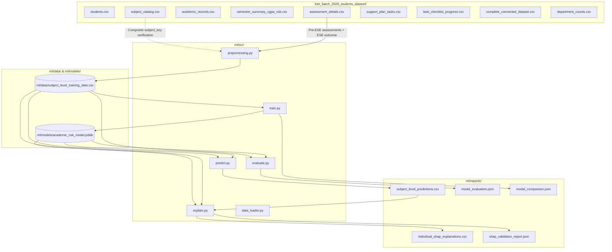

# Data Lineage Document
**Project:** AI Student Academic Risk Early Warning System  
**Batch:** KIET Batch 2024–2028 (Synthetic Demo Dataset)  
**Date:** October 2026  

---

## 1. Lineage Overview

The academic risk early warning system operates on a multi-stage data pipeline that transforms raw student and assessment records into subject-level training data, trains regularized ML models, generates calibrated predictions with risk tiers across the entire cohort, and computes mathematically closed individual feature explanations.

---

## 2. Source Datasets Inventory

| File Path | Rows | Cols | Primary Key | Description |
|---|---|---|---|---|
| `kiet_batch_2028_students_dataset/students.csv` | 1,530 | 8 | `student_id` | Student master table with program, department, and section. |
| `kiet_batch_2028_students_dataset/subject_catalog.csv` | 231 | 6 | `(department_code, subject_id)` | Catalog of all courses with credits and components across departments. |
| `kiet_batch_2028_students_dataset/academic_records.csv` | 47,550 | 33 | `(student_id, department_code, subject_id, semester)` | Semester-by-semester subject performance, attendance, component marks, and provisional results. |
| `kiet_batch_2028_students_dataset/semester_summary_cgpa_risk.csv` | 7,650 | 11 | `(student_id, semester)` | Student semester GPA, cumulative CGPA, semester attendance, and pass counts. |
| `kiet_batch_2028_students_dataset/assessment_details.csv` | 451,500 | 11 | `(student_id, department_code, subject_id, semester, assessment_type, assessment_number)` | Granular assessment log containing individual marks obtained and max marks. |
| `kiet_batch_2028_students_dataset/support_plan_tasks.csv` | 3,060 | 16 | `task_id` | Remedial intervention tasks assigned by mentors/teachers for Semester 5. |
| `kiet_batch_2028_students_dataset/task_checklist_progress.csv` | 13,796 | 5 | `checklist_item_id` | Actionable milestones per task with completion status and timestamps. |
| `kiet_batch_2028_students_dataset/complete_connected_dataset.csv` | 47,550 | 49 | `(student_id, semester, subject_id)` | Denormalized reference joining academic, student, semester summary, and task indicators. |
| `kiet_batch_2028_students_dataset/department_counts.csv` | 22 | 4 | `(department_code, section)` | Administrative summary of student enrollment counts by department and section. |

---

## 3. Data Processing & Artifact Generation Stages

### Stage 1: Subject-Level Aggregation (`ml/src/preprocessing.py`)
- **Inputs:** `kiet_batch_2028_students_dataset/assessment_details.csv`
- **Operations:**
  1. Computes composite `subject_key = f"{department_code}_{subject_id}"` to resolve cross-department subject code collisions (e.g. `IT301L`).
  2. Filters `assessment_type` to pre-ESE assessments: `["Mid Semester", "Class Test", "Assignment", "Other Internal"]`.
  3. Converts raw marks to normalized percentage: $\text{percentage} = (\text{marks\_obtained} / \text{max\_marks}) \times 100$.
  4. Pivots assessments into dedicated feature columns (`assignment_1`..`6`, `class_test_1`..`2`, `mid_semester_1`, `other_internal_1`).
  5. Computes assignment completion rate: $\text{assignments\_submitted} / \text{assignment\_count} \times 100$.
  6. Merges provisional ESE outcome: `ese_percentage` and binary target `ese_below_40_percent = int(ese_percentage < 40)`.
- **Output:** `ml/data/subject_level_training_data.csv` (47,550 rows $\times$ 22 columns).

### Stage 2: Model Training & Comparison (`ml/src/train.py`)
- **Inputs:** `ml/data/subject_level_training_data.csv`
- **Operations:**
  1. Partitions data using `GroupShuffleSplit(n_splits=1, test_size=0.20, random_state=42)` grouped by `student_id` (0 student overlap).
  2. Excludes identifier and outcome fields: `[ese_below_40_percent, student_id, student_name, ese_percentage, subject_id, subject_name]`.
  3. Applies `ColumnTransformer`:
     - Numeric: `SimpleImputer(strategy='median')` followed by `StandardScaler()`.
     - Categorical: `SimpleImputer(strategy='most_frequent')` followed by `OneHotEncoder(handle_unknown='ignore')` on `department_code`, `section`, and composite `subject_key`.
  4. Trains and compares `LogisticRegression(class_weight='balanced')` and `RandomForestClassifier(class_weight='balanced')`.
  5. Selects top performer by macro F1 score.
- **Outputs:**
  - `ml/models/academic_risk_model.joblib` (Trained pipeline)
  - `ml/reports/model_comparison.json` (Comparative evaluation report)

### Stage 3: Standalone Held-Out Evaluation (`ml/src/evaluate.py`)
- **Inputs:** `ml/models/academic_risk_model.joblib`, `ml/data/subject_level_training_data.csv`
- **Operations:**
  1. Re-creates exact held-out test split (9,293 records across 306 distinct students).
  2. Computes accuracy, macro F1, below-40% class precision, recall, and F1.
  3. Extracts confusion matrix and explicitly reports missed high-risk cases (False Negatives).
- **Output:** `ml/reports/model_evaluation.json`

### Stage 4: Full Prediction Generation (`ml/src/predict.py`)
- **Inputs:** `ml/models/academic_risk_model.joblib`, `ml/data/subject_level_training_data.csv`
- **Operations:**
  1. Generates model probability $P(\text{ESE} < 40\%)$ across all 47,550 student-subject records.
  2. Assigns provisional risk tiers: `Low` $(\le 0.30)$, `Moderate` $(0.30, 0.60]$, `High` $(> 0.60)$.
  3. Binds predictions to full student and course metadata.
- **Output:** `ml/reports/subject_level_predictions.csv` (47,550 rows $\times$ 25 columns).

### Stage 5: Sampled SHAP Explanation with Residual Closure (`ml/src/explain.py`)
- **Inputs:** `ml/models/academic_risk_model.joblib`, `ml/data/subject_level_training_data.csv`, `ml/reports/subject_level_predictions.csv`
- **Operations:**
  1. Samples 100 deterministic student-subject records (`seed=42`).
  2. Uses model-agnostic `PermutationExplainer` on numerical dense transformed space.
  3. Computes top-10 absolute feature contributions.
  4. Maps transformed z-scores to interpretable original assessment percentages (`feature_value_original`).
  5. Computes exact mathematical residual of omitted features: $\text{residual} = (\text{reconstructed\_prob} - \text{base\_prob}) - \sum_{k=1}^{10} \text{top\_shap}_k$.
  6. Appends residual row (Rank 11) for full additivity closure.
- **Outputs:**
  - `ml/reports/individual_shap_explanations.csv` (1,100 rows $\times$ 16 columns)
  - `ml/reports/shap_validation_report.json`

---

## 4. Reusable Loader Module (`ml/src/data_loader.py`)

A centralized Python module `ml.src.data_loader` provides programmatic access to all datasets with automatic `subject_key` generation and feature-target separation, ensuring future backend services and batch jobs share a single source of truth.
